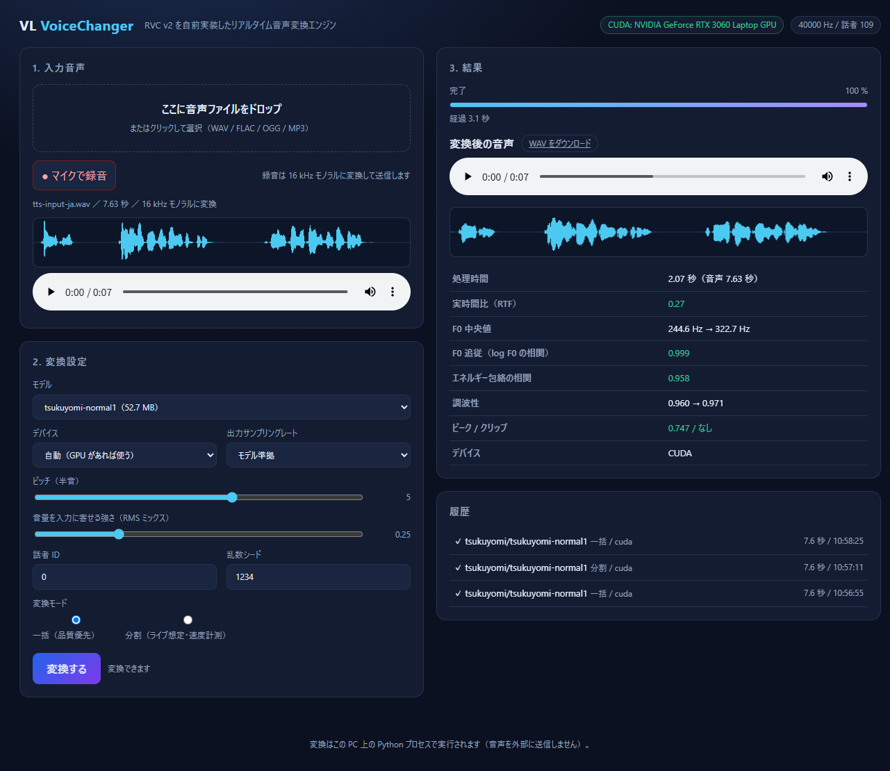

# 08. ブラウザ UI（自前エンジン）

`engine/` の変換を**ブラウザから操作する**ための Web UI。音声をドロップまたはマイクで録音し、
ピッチなどの設定を変えながら変換・試聴・ダウンロードできる。



変換そのものはこの PC 上の Python プロセス（PyTorch + ONNX Runtime）で実行する。
ブラウザは UI と音声の受け渡しを担当する。音声は接続先のサーバーへ送信される。
自分の PC 上でサーバーを起動した場合は、その PC 内で処理される。

- 既定の待ち受け: `http://127.0.0.1:8765`（この PC からのみ）
- 実装: `engine/web/server.py`（FastAPI）+ `engine/web/static/`（HTML / CSS / JS、ビルド不要）

## 1. 起動

### 開発用: npm run dev

Node.js 18 以上と Python 3.10 以上をインストールし、リポジトリのルートで実行する。

```bash
npm run dev
```

初回に Python 依存が不足していれば `.venv` を作り、CPU 版 PyTorch と Web UI の依存を導入する。
Node の外部依存はないので `npm install` は不要。
準備が済むと `http://127.0.0.1:3000` で Web UI が開く。
Windows/macOS や GUI のある Linux ではブラウザを自動で開く。ヘッドレス環境は表示されたアドレスを手動で開く。
Python の変更は自動リロード、UI の変更はブラウザ更新で反映する。停止は Ctrl+C。

```bash
npm run dev -- --port 9000
npm run dev -- --no-open
npm run dev -- --open
npm run setup
```

既存の仮想環境を有効化していればそれを使う。`VLVC_PYTHON` で Python 実行ファイルを指定することも可能。
CUDA 版 PyTorch がインストール済みなら保持する。初回の依存導入にはネットワーク接続が必要。
モデルなしでも画面は確認できるが、マイク変換には RVC / ContentVec / RMVPE の資産が必要。

### Python から起動

```bash
# 依存関係（初回のみ。すでに入っていれば不要）
python -m vlvc setup

# 起動（ブラウザも開く）
python -m vlvc serve

# 起動だけ（ブラウザを開かない）
python -m vlvc serve --no-browser
# → http://127.0.0.1:8765
```

`python -m engine serve` でも起動できる（`vlvc serve` は依存確認とブラウザ起動を行う）。

```bash
python -m vlvc serve --port 9000       # ポート変更
python -m vlvc serve --no-browser      # ブラウザを開かない
```

停止は `Ctrl+C`。

## 2. 画面の使い方

1. **入力音声**: 音声ファイルをドラッグ&ドロップ、または「マイクで録音」。
   入力はブラウザ側で **16 kHz モノラルの WAV** に変換してから送る（元ファイルは変更しない）。
2. **（任意）入力だけにノイズ除去**: 「ノイズ除去を試す」を押すと、読み込み済みの音声に
   スペクトルサブトラクションをかける（強さは変換設定の「ノイズ除去」、ハムは「ハム除去」を使用）。
   結果はその場で試聴でき、「元に戻す」で元の音声に戻せる。
   適用すると二重がけを避けるため、変換時の除去設定は 0 に戻る。
3. **変換設定**:
   - モデル: `models/**/*.pth` を自動列挙（RVC v2 のみ）
   - デバイス: 自動 / CUDA / CPU
   - ピッチ（半音、-24〜+24）、音量を入力に寄せる強さ（RMS ミックス）
   - **ノイズ除去**（空調・ファンなどの定常ノイズ。0 で無効、0.5 前後が無難）
   - **ハム除去**（電源ノイズ。なし / 50 Hz / 60 Hz）
   - 出力サンプリングレート（モデル準拠 / 48k / 44.1k / 32k / 24k / 16k）
   - モード: **一括**（品質優先）/ **分割**（ライブ想定。hop / context / crossfade を指定）
4. **変換する** を押すと進捗（段階・%）が出る。完了すると変換後の音声・波形・数値が表示される。
5. **WAV をダウンロード** で保存。履歴をクリックすると過去の結果を再表示できる。

数値は CLI（`python -m vlvc quality`）と同じ指標を使う:
F0 中央値・F0 追従（log F0 の相関）・エネルギー包絡の相関・調波性・ピーク/クリップ・
ノイズフロア（入力 → 出力）。
分割モードでは RTF・区間あたり遅延・継ぎ目の跳びも出る。

### マイクのストリーミング変換（試験機能）

録音が終わるのを待たずに、話しながら変換音声を再生できる。

```bash
python -m pip install -e ".[engine,web]"
python -m engine serve
```

1. `models/` の RVC v2 `.pth` と ContentVec/RMVPE の ONNX を用意する。
   ONNX の場所は従来どおり `modules/` または `VL_CONTENTVEC_ONNX` / `VL_RMVPE_ONNX`。
2. サーバーの画面を localhost または HTTPS で開く。**ヘッドホン**を使用する。
3. モデル・デバイス・ピッチなどを選び、ノイズ除去・ハム除去を **0** にする。
   「区間プリセット → 低遅延・試験」で hop 200 / context 60 / crossfade 20 ms にまとめて切り替えられる。
   入力蓄積は従来の700 msから280 msになる。戻す場合は「従来設定」を選ぶ。
   280 ms設定で音質が厳しい場合は、先読みとクロスフェードを維持する「品質寄り低遅延・試験」（500 ms）を比較する。
   「分割」を選ぶと hop / context / crossfade の設定が表示される。
   マイク変換は「一括」を選んでいてもストリーミングで処理される。
4. **マイク変換を開始**を押してマイクを許可する。モデル準備後に音声の送信が始まり、
   変換できた区間から再生される。入力/出力秒数、推論 RTF・最大推論時間、
   再生途切れ回数、送信待ち・再生待ちを確認できる。
5. **停止して残りを再生**を押すと、マイクを停止して送信待ちと残りの完成フレームを処理する。
   さらに **すぐに切断**を押すと残りを破棄して停止する。停止後は再開できる。

低遅延プリセットの計測根拠・比較方法は [15-low-latency-preset.md](15-low-latency-preset.md) を参照。

既定設定では最初の推論までに **700 ms** の入力が必要で、推論・通信・再生の時間が加わる。
因果モデルや特徴量キャッシュではなく、ライブ用途で使える低遅延・音質は保証しない。
CPU などで処理が遅いと送信待ちが 2 秒を超えて停止する。hop・デバイスを見直して再開する。
再生待ちも 3 秒を超えたら停止し、遅延を際限なく蓄積しない。1 セッションは 180 秒まで。
初回推論はマイク開始前に代表的な2つの区間長で事前準備する。
準備時間は画面に別表示し、入力・出力・遅延統計には含めない。
入力中の推論が継続的に遅い場合は、従来どおり上限で停止する。

マイク変換とファイル変換、複数のマイク変換は同時実行できない。別のタブも含めて停止・完了してから再接続する。
通信切断やマイク拒否・エラー時は音声トラックと再生キューを解放する。
切断時点で実行中の推論・事前準備が終わるまで、サーバーが次の接続を待たせる場合がある。
タブをバックグラウンドにするとブラウザが音声処理を中断する場合があるため、画面を開いたまま使う。
このモードは入力や出力を履歴・WAV に保存しない。従来の録音・ファイル変換はそのまま利用できる。
「デバイス」の CUDA は合成器に適用される。「特徴抽出の高速化」を **GPU / CUDA（試験）** にすると、
ContentVec と RMVPE も CUDA 優先で動かす。既定の CPU 設定は従来と同じ。
開始後に実セッションのプロバイダーと、ピッチ推定・音声特徴・合成・後処理の区間あたり平均時間を表示する。
導入と比較方法は [13-web-onnx-cuda.md](13-web-onnx-cuda.md) を参照。

公開サーバーでは HTTPS と WebSocket Upgrade の転送が必要。複数 worker ではセッションの排他が共有されないため、
既存の運用どおり **1 worker** で起動する。認証は既存の公開サーバー側で管理する。

### debug モード

開始前に「debug モード：遅延の内訳を表示」をオンにすると、
入力蓄積・送信待ち・サーバー処理・推論の内訳・往復時間・再生開始予定までを計測する。
直近300出力の p50 / p95 / 最大値と、音声を含まない診断JSONを保存できる。
通常モードは従来のバイナリ音声プロトコルを維持する。
実測・推定・未計測の範囲は [14-streaming-debug.md](14-streaming-debug.md) を参照。

### 特徴量キャッシュ（試験）

マイク変換の「特徴量キャッシュ」をオンにすると、重なった古いF0 / ContentVec特徴量を再利用する。
境界は設定したcontext以上（最低100 ms）再計算し、20 msの特徴量位置が変わる場合は全量計算へ戻す。
入力蓄積設定は変えないが、非因果モデルの結果は完全一致しないため、既定OFF。
画面とdebug JSONに再利用・省略フレーム数を表示する。ファイル変換には適用しない。
[詳細・同じWAVでの比較方法](16-stream-feature-cache.md)。

## 3. GPU での実測（2026-10-28 / RTX 3060 Laptop 6 GB）

入力 7.63 秒（`logs/verify/tts-input-ja.wav`）、モデル `tsukuyomi-normal1`（40 kHz）。

| 条件 | 処理時間 | RTF | 備考 |
| :--- | ---: | ---: | :--- |
| 一括・初回（プロセス起動後 1 回目） | 7.12 秒 | 0.93 | CUDA カーネルの初期化を含む |
| 一括・2 回目以降（モデル常駐） | 2.07〜3.13 秒 | 0.27〜0.41 | Web UI の実測 |
| 分割（hop 0.5 / context 0.15 / crossfade 0.05） | 12.5〜15.3 秒 | 1.64〜2.08 | 区間遅延 平均 780〜990 ms / 最大 1.2〜2.1 秒（初回区間を含む） |

- 一括変換は GPU で実時間より速い（RTF < 1）。**ファイル変換用途は実用域**。
- 分割変換は **1 区間（0.5 秒）あたり 0.8〜1.3 秒**かかり（初回区間はウォームアップで
  2 秒程度）、ライブ成立条件（最大遅延 < hop）を満たさない。区間ごとの固定費
  （ContentVec の ONNX 呼び出しが CPU、合成器の起動）が支配的で、区間を細かくするほど不利になる。
- 品質は一括・分割とも F0 追従 0.999 / 包絡相関 0.96〜0.97 で差がない
  （時間ずれと継ぎ目は `docs/07-own-engine.md` の対策済み）。

## 4. API（自動化・連携用）

| メソッド | パス | 内容 |
| :--- | :--- | :--- |
| `GET` | `/api/health` | torch / CUDA / 既定デバイス / 制限値 |
| `WebSocket` | `/api/stream` | マイクの逐次変換（プロトコルは下記） |
| `GET` | `/api/models` | モデル一覧（`id` は `models/` からの相対パス、拡張子なし） |
| `GET` | `/api/models/{id}` | サンプリングレート・話者数・バージョン |
| `POST` | `/api/jobs` | 変換ジョブ作成（multipart。`audio` + 設定） |
| `GET` | `/api/jobs` | 最近のジョブ（既定 20 件） |
| `GET` | `/api/jobs/{id}` | 状態・進捗・実測値・メトリクス |
| `GET` | `/api/jobs/{id}/audio` | 変換後 WAV（`?which=input` で入力） |
| `POST` | `/api/jobs/{id}/cancel` | 中断（分割変換は区間の切れ目で止まる） |
| `DELETE` | `/api/jobs/{id}` | ジョブと音声を削除 |
| `POST` | `/api/denoise` | **入力音声だけにノイズ除去**（変換しない。結果はすぐ返る） |
| `GET` | `/api/denoise/{id}/audio` | 除去後の WAV |

`POST /api/jobs` の主なフィールド:

| フィールド | 既定 | 内容 |
| :--- | :--- | :--- |
| `audio` | — | 音声ファイル（WAV / FLAC / OGG / MP3、80 MB・180 秒まで） |
| `model` | — | `/api/models` の `id` |
| `device` | `auto` | `auto` / `cuda` / `cpu` |
| `pitch` | `0` | 半音（-24〜24 に丸める） |
| `speaker` | `0` | 話者 ID |
| `rms_mix` | `0.25` | 0〜1 |
| `seed` | `1234` | -1 で毎回ランダム |
| `output_sr` | `0` | 0 でモデル準拠 |
| `mode` | `batch` | `batch` / `chunk` |
| `hop` / `context` / `crossfade` | `0.5` / `0.15` / `0.05` | 分割モードの設定（秒） |
| `denoise` | `0` | ノイズ除去の強さ 0〜1 |
| `dehum` | `0` | 電源ハム除去（`0` / `50` / `60` Hz） |
| `metrics` | `true` | 変換後に品質指標を計算する |

例（bash / curl。Windows の PowerShell では `curl` が別名のため `curl.exe` を使う）:

```bash
id=$(curl -s -X POST http://127.0.0.1:8765/api/jobs \
  -F "audio=@logs/verify/tts-input-ja.wav" \
  -F "model=tsukuyomi/tsukuyomi-normal1" -F "device=cuda" -F "pitch=0" \
  | python -c "import json,sys; print(json.load(sys.stdin)['id'])")

curl -s "http://127.0.0.1:8765/api/jobs/$id" | python -m json.tool
curl -s "http://127.0.0.1:8765/api/jobs/$id/audio" -o out.wav
```

### 入力音声だけにノイズ除去をかける（任意ステップ）

画面の「ノイズ除去を試す」ボタンと同じ処理。**変換せずに**音声だけをきれいにする。
数秒の音声なら 0.1 秒未満で返るので、結果を確認してから変換できる。

```bash
curl -s -X POST http://127.0.0.1:8765/api/denoise \
  -F "audio=@logs/verify/tts-input-ja-noisy-loud.wav" \
  -F "strength=0.7" -F "dehum=50" -o denoise.json

python -c "import json; d=json.load(open('denoise.json', encoding='utf-8')); print(f\"{d['before_db']} -> {d['after_db']} dBFS ({d['seconds']} 秒)\"); print(d['audio'])"

# 表示された audio のパス（例: /api/denoise/xxxx/audio）で保存
curl -s "http://127.0.0.1:8765/api/denoise/<id>/audio" -o cleaned.wav
```

`strength` は 0〜1、`dehum` は `0` / `50` / `60`。結果は直近 20 件だけ保持する。

### WebSocket のストリーミングプロトコル

同じサーバーの `/api/stream` に接続する。別 origin のブラウザ接続は拒否する。

1. JSON の開始設定を送る。例:
   `{"type":"start","model":"tsukuyomi/tsukuyomi-normal1","device":"auto","hop":0.5,"context":0.15,"crossfade":0.05}`。
   `pitch`, `speaker`, `rms_mix`, `seed`, `output_sr`, `ort_cuda`, `debug`（後二者は既定 false）も指定できる。
   `warmup` は既定 true。false は事前準備を省略する診断用で、通常は変更しない。
   `feature_cache` は既定 false。true は境界再計算付き特徴量キャッシュの試験。
   `denoise` / `dehum` は 0 のみ。範囲外の設定や未定義フィールドは拒否される。
2. サーバーから `{"type":"ready","input_sr":16000,"output_sr":40000,...}` が返る。
   `buffer_ms` は入力蓄積の下限で、実測遅延ではない。
   `feature_providers` は ContentVec / RMVPE の実セッションのプロバイダー一覧。
   `warmup_ms` はマイク開始前の準備時間。ready は代表区間の推論と出力長の検証後に返す。
3. **16 kHz mono / little-endian float32** をバイナリで送る。推奨 320 サンプル（20 ms）、
   最大 1600 サンプル（100 ms）。WAV ヘッダーは付けない。
   1 パケットごとに `ack` が返るまで次を送らない。
4. 出力ができた場合、`ack` の前に **ready の output_sr / mono / little-endian float32**
   のバイナリが返る。`ack` は入力がまだ蓄積中でも必ず返り、フレーム数と推論統計を含む。
   `stage_ms` は完了した全区間の段階別平均時間（ms）。計測を返さない backend では空。
5. `{"type":"stop"}` を送ると残りを flush し、バイナリ音声（あれば）、`done`、正常切断の順に返る。
   入力末尾の 10 ms 未満の端数だけを捨てる。切断後の再接続は新しい状態から始まる。

`{"type":"error","message":"..."}` は設定・モデル不足・異常出力・受信タイムアウトなどを示す。
初期設定は 10 秒以内、音声や stop の間隔は 30 秒以内。180 秒を超える入力は拒否する。
ストリーミング中のファイルジョブ作成は HTTP 409、別の変換が実行中のストリーム接続は error になる。

テスト:

```bash
python -m pip install -e ".[engine,web,test]"
python -m unittest discover -s tests -v
node --test tests/test_stream_audio.mjs

# ブラウザの結合テスト（実モデルの代わりにテスト専用の模擬変換器を使用）
python -m pip install playwright
python -m playwright install chromium
python tests/browser_streaming_smoke.py -v
```

システムの Chromium も利用可能。`VLVC_TEST_CHROMIUM` で実行ファイルを指定できる。
ブラウザテストは模擬マイクの既知波形を使い、送信・逐次再生・停止・再開・異常時の解放を確認する。
実モデルの音質や GPU 性能はこのテストの対象外。

## 5. 設計と制約

- **ジョブは 1 本のワーカースレッドで直列実行**。GPU を奪い合わず、
  複数人が同時に押しても順番に処理する。
- 変換器（モデル + ONNX）はプロセス内に **2 つまでキャッシュ**。
  2 回目以降はモデル読み込み（約 9 秒）が不要になる。
- ジョブはメモリに 40 件まで保持。音声は `logs/web/<job_id>/`（Git 管理外）に置き、
  上限を超えた古いものから削除する。
- **履歴（ジョブ）はサーバーを再起動すると消える**。音声ファイル自体は `logs/web/` に残る。
- 入力ノイズ除去の結果は `logs/web/denoise/` に直近 20 件だけ残す。
- UI の静的ファイルは `Cache-Control: no-store` で配信し、さらに `?v=<更新時刻>` を自動で付ける。
  画面を直しても古い JavaScript が使われない（それでも古い画面が出る場合は `Ctrl+F5`）。
- 待ち受けは既定で **127.0.0.1 のみ**。同じ LAN から使う場合だけ `--host 0.0.0.0` にする
  （認証は無いので、共用ネットワークでは公開しない）。
- 「分割モード」でのファイル変換は**録音済み音声を区間分割して処理し、速度を測る**もの。
  マイクの逐次送信・再生には別の「マイク変換を開始」ボタンを使う。

## 6. トラブルシューティング

| 症状 | 確認すること |
| :--- | :--- |
| 起動時に `ModuleNotFoundError: fastapi` | `pip install -e ".[engine,web]"` |
| 画面は出るがモデルが空 | `models/**/*.pth` に RVC v2 のモデルを置く（v1 は非対応） |
| 「モデルが見つかりません」 | モデルを置いた後にページを再読み込みする |
| 変換が遅い / CPU になる | ヘッダーのバッジが `CPU のみ` なら CUDA 版 torch か GPU を確認 |
| 音声が再生されない | 変換完了後にブラウザの自動再生制限で止まる場合は、プレイヤーの再生を押す |
| マイクが使えない | ブラウザのマイク許可と、Windows の入力デバイスを確認（`docs/03-troubleshooting.md`） |
| WebSocket に接続できない | web extras の再インストール、リバースプロキシの Upgrade 転送、HTTPS と Host/Origin の一致を確認 |
| 「入力に追いつかない」で停止 | 送信待ちが 2 秒を超えている。現行版はマイク開始前に初回事前準備を行う。続く場合は debug JSON で推論時間・応答待ちを確認する |
