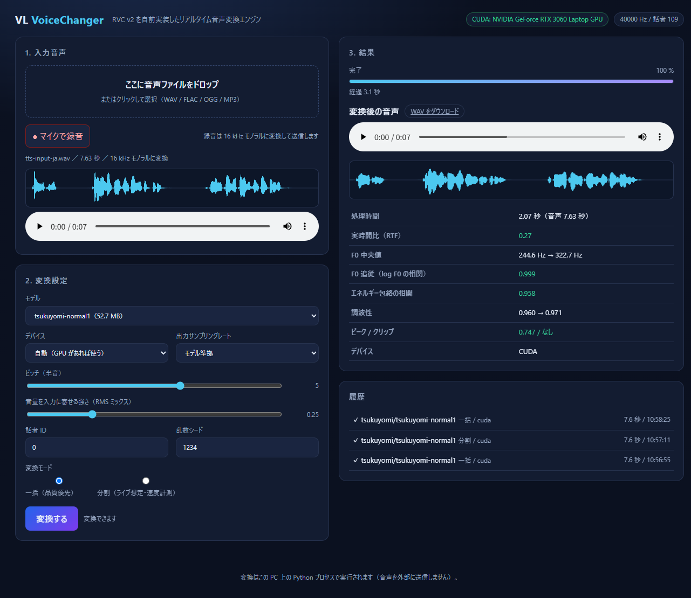

# 08. ブラウザ UI（自前エンジン）

`engine/` の変換を**ブラウザから操作する**ための Web UI。音声をドロップまたはマイクで録音し、
ピッチなどの設定を変えながら変換・試聴・ダウンロードできる。



変換そのものはこの PC 上の Python プロセス（PyTorch + ONNX Runtime）で実行する。
ブラウザは UI と音声の受け渡しだけを担当するため、**音声が外部に送信されることはない**。

- 既定の待ち受け: `http://127.0.0.1:8765`（この PC からのみ）
- 実装: `engine/web/server.py`（FastAPI）+ `engine/web/static/`（HTML / CSS / JS、ビルド不要）

## 1. 起動

```powershell
# 依存関係（初回のみ。すでに入っていれば不要）
.\.venv\Scripts\python.exe -m pip install fastapi uvicorn python-multipart

# 起動
.\.venv\Scripts\python.exe -m engine serve
# → ブラウザで http://127.0.0.1:8765 を開いてください
```

`scripts/Start-Web.ps1` でも同じことができる（ポート変更・ブラウザ自動起動つき）。

```powershell
.\scripts\Start-Web.ps1                 # 8765 で起動してブラウザを開く
.\scripts\Start-Web.ps1 -Port 9000      # ポート変更
.\scripts\Start-Web.ps1 -NoBrowser      # ブラウザを開かない
```

停止は `Ctrl+C`。

## 2. 画面の使い方

1. **入力音声**: 音声ファイルをドラッグ&ドロップ、または「マイクで録音」。
   入力はブラウザ側で **16 kHz モノラルの WAV** に変換してから送る（元ファイルは変更しない）。
2. **変換設定**:
   - モデル: `models/**/*.pth` を自動列挙（RVC v2 のみ）
   - デバイス: 自動 / CUDA / CPU
   - ピッチ（半音、-24〜+24）、音量を入力に寄せる強さ（RMS ミックス）
   - **ノイズ除去**（空調・ファンなどの定常ノイズ。0 で無効、0.5 前後が無難）
   - **ハム除去**（電源ノイズ。なし / 50 Hz / 60 Hz）
   - 出力サンプリングレート（モデル準拠 / 48k / 44.1k / 32k / 24k / 16k）
   - モード: **一括**（品質優先）/ **分割**（ライブ想定。hop / context / crossfade を指定）
3. **変換する** を押すと進捗（段階・%）が出る。完了すると変換後の音声・波形・数値が表示される。
4. **WAV をダウンロード** で保存。履歴をクリックすると過去の結果を再表示できる。

数値は CLI（`scripts/measure_quality.py`）と同じ指標を使う:
F0 中央値・F0 追従（log F0 の相関）・エネルギー包絡の相関・調波性・ピーク/クリップ・
ノイズフロア（入力 → 出力）。
分割モードでは RTF・区間あたり遅延・継ぎ目の跳びも出る。

## 3. GPU での実測（2026-10-28 / RTX 3060 Laptop 6 GB）

入力 7.63 秒（`logs/verify/tts-input-ja.wav`）、モデル `tsukuyomi-normal1`（40 kHz）。

| 条件 | 処理時間 | RTF | 備考 |
| :--- | ---: | ---: | :--- |
| 一括・初回（プロセス起動後 1 回目） | 7.12 秒 | 0.93 | CUDA カーネルの初期化を含む |
| 一括・2 回目以降（モデル常駐） | 2.07〜3.13 秒 | 0.27〜0.41 | Web UI の実測 |
| 分割（hop 0.5 / context 0.15 / crossfade 0.05） | 12.5〜15.3 秒 | 1.64〜2.08 | 区間遅延 平均 780〜990 ms / 最大 1.2〜2.1 秒（初回区間を含む） |

- 一括変換は GPU で実時間より速い（RTF < 1）。**ファイル変換用途は実用域**。
- 分割変換は **1 区間（0.5 秒）あたり 0.8〜1.3 秒**かかり（初回区間はウォームアップで
  2 秒程度）、ライブ成立条件（最大遅延 < hop）を満たさない。区間ごとの固定費
  （ContentVec の ONNX 呼び出しが CPU、合成器の起動）が支配的で、区間を細かくするほど不利になる。
- 品質は一括・分割とも F0 追従 0.999 / 包絡相関 0.96〜0.97 で差がない
  （時間ずれと継ぎ目は `docs/07-own-engine.md` の対策済み）。

## 4. API（自動化・連携用）

| メソッド | パス | 内容 |
| :--- | :--- | :--- |
| `GET` | `/api/health` | torch / CUDA / 既定デバイス / 制限値 |
| `GET` | `/api/models` | モデル一覧（`id` は `models/` からの相対パス、拡張子なし） |
| `GET` | `/api/models/{id}` | サンプリングレート・話者数・バージョン |
| `POST` | `/api/jobs` | 変換ジョブ作成（multipart。`audio` + 設定） |
| `GET` | `/api/jobs` | 最近のジョブ（既定 20 件） |
| `GET` | `/api/jobs/{id}` | 状態・進捗・実測値・メトリクス |
| `GET` | `/api/jobs/{id}/audio` | 変換後 WAV（`?which=input` で入力） |
| `POST` | `/api/jobs/{id}/cancel` | 中断（分割変換は区間の切れ目で止まる） |
| `DELETE` | `/api/jobs/{id}` | ジョブと音声を削除 |

`POST /api/jobs` の主なフィールド:

| フィールド | 既定 | 内容 |
| :--- | :--- | :--- |
| `audio` | — | 音声ファイル（WAV / FLAC / OGG / MP3、80 MB・180 秒まで） |
| `model` | — | `/api/models` の `id` |
| `device` | `auto` | `auto` / `cuda` / `cpu` |
| `pitch` | `0` | 半音（-24〜24 に丸める） |
| `speaker` | `0` | 話者 ID |
| `rms_mix` | `0.25` | 0〜1 |
| `seed` | `1234` | -1 で毎回ランダム |
| `output_sr` | `0` | 0 でモデル準拠 |
| `mode` | `batch` | `batch` / `chunk` |
| `hop` / `context` / `crossfade` | `0.5` / `0.15` / `0.05` | 分割モードの設定（秒） |
| `denoise` | `0` | ノイズ除去の強さ 0〜1 |
| `dehum` | `0` | 電源ハム除去（`0` / `50` / `60` Hz） |
| `metrics` | `true` | 変換後に品質指標を計算する |

例:

```powershell
$id = (curl.exe -s -X POST http://127.0.0.1:8765/api/jobs `
  -F "audio=@logs/verify/tts-input-ja.wav" `
  -F "model=tsukuyomi/tsukuyomi-normal1" -F "device=cuda" -F "pitch=0" |
  ConvertFrom-Json).id

Invoke-RestMethod "http://127.0.0.1:8765/api/jobs/$id" | ConvertTo-Json -Depth 5
Invoke-WebRequest "http://127.0.0.1:8765/api/jobs/$id/audio" -OutFile out.wav
```

## 5. 設計と制約

- **ジョブは 1 本のワーカースレッドで直列実行**。GPU を奪い合わず、
  複数人が同時に押しても順番に処理する。
- 変換器（モデル + ONNX）はプロセス内に **2 つまでキャッシュ**。
  2 回目以降はモデル読み込み（約 9 秒）が不要になる。
- ジョブはメモリに 40 件まで保持。音声は `logs/web/<job_id>/`（Git 管理外）に置き、
  上限を超えた古いものから削除する。
- **履歴（ジョブ）はサーバーを再起動すると消える**。音声ファイル自体は `logs/web/` に残る。
- UI の静的ファイルは `Cache-Control: no-store` で配信する。画面の更新がそのまま反映される
  （それでも古い画面が出る場合はスーパーリロード `Ctrl+F5`）。
- 待ち受けは既定で **127.0.0.1 のみ**。同じ LAN から使う場合だけ `--host 0.0.0.0` にする
  （認証は無いので、共用ネットワークでは公開しない）。
- 音声デバイス（マイク → スピーカー）のリアルタイム経路は未実装。
  現状の「分割モード」は**録音済み音声を区間分割して処理し、速度を測る**もの。

## 6. トラブルシューティング

| 症状 | 確認すること |
| :--- | :--- |
| 起動時に `ModuleNotFoundError: fastapi` | `pip install fastapi uvicorn python-multipart` |
| 画面は出るがモデルが空 | `models/**/*.pth` に RVC v2 のモデルを置く（v1 は非対応） |
| 「モデルが見つかりません」 | モデルを置いた後にページを再読み込みする |
| 変換が遅い / CPU になる | ヘッダーのバッジが `CPU のみ` なら CUDA 版 torch か GPU を確認 |
| 音声が再生されない | 変換完了後にブラウザの自動再生制限で止まる場合は、プレイヤーの再生を押す |
| マイクが使えない | ブラウザのマイク許可と、Windows の入力デバイスを確認（`docs/03-troubleshooting.md`） |
